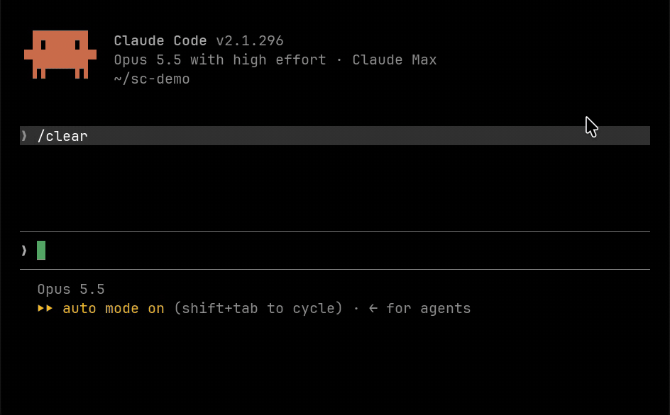

# Slash Command

**ホットキー一つで、会話を離れずにコーディングエージェントのモデルと推論の強さ(effort)を切り替えます。**

[English](README.md) · [한국어](README.ko.md) · [简体中文](README.zh-CN.md) · [Español](README.es.md)

**[macOS 版をダウンロード](https://github.com/yohangwak/slash-command/releases/latest/download/Slash-Command.dmg)** · macOS 13 以降 · Apple シリコンと Intel  
**[Windows 版をダウンロード](https://github.com/yohangwak/slash-command/releases/latest/download/Slash-Command-Windows-x64.zip)** · Windows 11 · x64



Slash Command は macOS のメニューバーアプリ、そして Windows のトレイアプリです。ターミナルで **⇧⌥1 … ⇧⌥9**(Windows では **Shift+Alt+1 … 9**)を押すと、最前面のセッションのエージェントがそのプリセットの **モデル + effort** に切り替わります。**⇧⌥=** と **⇧⌥-** は effort を一段階上げ下げします。

**Claude Code、Codex、Grok、Cursor Agent、Antigravity、OpenCode** に対応し、macOS では **Ghostty、Orca、iTerm2、WezTerm、kitty**、Windows では **Windows Terminal、Orca、WezTerm** で動作します。

- `/model` を入力して、該当の行を探し、effort を設定する代わりに、**キー一つ**で済みます。
- **会話の途中でも使えます。** 入力中のテキストは入力欄にそのまま残ります。
- **対象は今のセッションだけです。** 新しいセッションの既定値は変わりません。
- **一つの番号で、どのエージェントにも。** プリセット 1 は、Claude Code では Opus、Codex では GPT 系のモデルを意味できます。アプリが最前面のエージェントを見て判断します。
- **慎重な設計です。** エージェントの入力欄が見えているときだけキーを送り、確信が持てないときは止まります。

## インストール

### macOS

macOS 13 以降が必要です。

1. [**Slash-Command.dmg**](https://github.com/yohangwak/slash-command/releases/latest/download/Slash-Command.dmg) をダウンロードします。
2. 開いて **Slash Command** を **Applications**(アプリケーション)にドラッグします。
3. 「アプリケーション」フォルダから Slash Command を開きます。メニューバーに `/` キーのアイコンが表示されます。
4. そのアイコンから **設定…** を開き、上部の **権限** ボックスを使います。ボタンを押すと、システム設定の該当のパネルが開きます。

**Homebrew** を使う場合は、手順 1・2 の代わりに次を実行します。

```sh
brew install --cask yohangwak/tap/slash-command
```

この方法では、コマンドラインツールも `slashcommand` としてリンクされます。

手順 4 の権限の用途:

| 権限 | 用途 |
|---|---|
| **アクセシビリティ**(macOS 27 では *Device Control and Data Access* と表示されます) | Ghostty の画面を読み取る、iTerm2 の Broadcast Input がオフであることを確認する |
| **オートメーション**(Slash Command → Ghostty、Slash Command → iTerm2) | ターミナルへの入力。そのターミナルで初めてホットキーを押したときに macOS が確認します |

WezTerm と kitty はどちらも不要で、Orca も権限なしで動作します。kitty はリモートコントロールを有効にする必要があります。[Terminals](docs/terminals.md) を参照してください。

ログイン時に起動するには、設定の **一般** にある **ログイン時に開く** をオンにします。

<details>
<summary>ソースからビルドする</summary>

```sh
git clone https://github.com/yohangwak/slash-command.git
cd slash-command
./scripts/build-app.sh --install   # builds, copies to ~/Applications, links ~/.local/bin/slashcommand if that folder exists
```

Swift ツールチェーン(Xcode または Command Line Tools)が必要です。署名証明書がない場合はアドホック署名でビルドされ、macOS はリビルドのたびに権限をもう一度確認します。

</details>

### Windows

x64 の Windows 11 が必要です。

1. [**Slash-Command-Windows-x64.zip**](https://github.com/yohangwak/slash-command/releases/latest/download/Slash-Command-Windows-x64.zip) をダウンロードします。
2. 右クリックして **すべて展開…** を選び、残しておくフォルダー(例: `%LOCALAPPDATA%\Programs`)に展開します。
3. 展開した **Slash Command** フォルダーの **Slash Command.exe** を開きます。通知領域に `/` キーのアイコンが表示されます。**^** の矢印の中に隠れていることがあります。
4. ログイン時に起動するには、アイコンをクリックして **ログイン時に開く** を選びます。

Windows 版はまだコード署名されていないため、初回に SmartScreen が「Windows によって PC が保護されました」と表示することがあります。**詳細情報** → **実行** を選んでください。各リリースでは zip の SHA-256 を `Slash-Command-Windows-x64.zip.sha256` に記載しています。

権限は不要です。コマンドラインツール `slashcommand.exe` は同じフォルダーにあります。

## 使い方

| キー | 動作 |
|---|---|
| `⇧⌥1` … `⇧⌥9` | 最前面のエージェントをそのプリセットのモデルと effort に切り替える |
| `⇧⌥=` / `⇧⌥-` | モデルはそのままで、effort を一段階上げる、または下げる |

画面の下部に小さな通知が表示され、エージェントが返した内容(たとえば `Opus 5.5 · high`)を確認できます。ホットキーは対応ターミナルが最前面にあるときだけ有効なので、ほかのアプリでは同じキーがいつもどおりに働きます。修飾キーは設定で変更できます。

メニューバーのアイコンには、最前面のセッションのエージェントと、各プリセットがそのエージェントに対して何をするかが表示されます。

**Windows では** キーは **Shift+Alt+1 … 9**、**Shift+Alt+=**、**Shift+Alt+-** で、トレイアイコンのメニューにも同じ内容が表示されます。Windows Terminal では Shift+Alt+= と Shift+Alt+- は「ペインを複製」のキーでもありますが、Windows Terminal が最前面の間は Slash Command が使います。Windows Terminal に残すには、プリセットファイルで `"effortKeys": false` にするか `modifiers` を変更してください。

## プリセット

プリセットは **設定… → プリセット** で編集するか、`~/.config/slashcommand/presets.json` を直接編集します。Windows では `%USERPROFILE%\.config\slashcommand\presets.json` で、トレイメニューの **プリセットファイルを開く** から開けます。Windows にはまだ設定ウィンドウがありません。

```json
{
  "version": 1,
  "slots": [
    { "claude": { "model": "opus",   "effort": "high" }, "codex": { "model": "gpt-6-astra", "effort": "high" } },
    { "claude": { "model": "sonnet", "effort": "high" }, "codex": { "model": "gpt-6.1-sol", "effort": "high" } },
    { "name": "夜間", "claude": { "model": "fable", "effort": "max" } }
  ]
}
```

プリセット番号は「意図」を表します。各プリセットはエージェントごとに一つの項目を持ち、ホットキーは最前面のエージェントの項目を使います。そのエージェントの項目がないプリセットは、そこでは何もしません。すべてのキーについては [Presets](docs/presets.md) を参照してください。

## コマンドライン

アプリには、同じ切り替えロジックを使うコマンドラインツールが付属しています。Homebrew でインストールした場合は、`slashcommand` としてそのまま呼び出せます。ディスクイメージからインストールした場合、ツールはアプリバンドルの中にあるので、一度リンクを作成します。

```sh
sudo mkdir -p /usr/local/bin
sudo ln -sf "/Applications/Slash Command.app/Contents/MacOS/slashcommand-cli" /usr/local/bin/slashcommand
```

Windows では `slashcommand.exe` が `Slash Command.exe` の隣にあります。そのフォルダーを `PATH` に追加すると `slashcommand` として呼び出せます。

その後:

```sh
slashcommand list              # the presets
slashcommand where             # the frontmost terminal and its agent
slashcommand doctor --screen   # check the target, screen reading and input box; sends nothing
slashcommand apply 2 --trace   # apply preset 2 and print the time per step
slashcommand run 2 claude      # open a new session with preset 2
```

## 対応状況

| ターミナル | 備考 |
|---|---|
| Ghostty | アクセシビリティとオートメーションが必要です。Ghostty 内の tmux にはまだ対応していません |
| Orca | 設定は不要です。アクセシビリティは任意で、許可するとタブの切り替えがすぐに反映されます |
| iTerm2 | オートメーションが必要です。Broadcast Input の確認にはアクセシビリティも必要です |
| WezTerm | 設定は不要です |
| kitty | 先にリモートコントロールを有効にします |
| tmux | Orca、iTerm2、WezTerm、kitty の内側で使えます |

Terminal.app と VS Code のターミナルには対応していません。

Windows:

| ターミナル | 備考 |
|---|---|
| Windows Terminal | 設定不要。Windows Terminal の外から引き渡されたペイン(スタートメニューから開いたシェルを Windows が Windows Terminal に渡した場合)には対応していません |
| Orca | 設定不要 |
| WezTerm | 設定不要。WSL・tmux・SSH を実行しているペインには対応していません。Grok、Cursor Agent、Antigravity、OpenCode は `keepDefaults` をオフにした場合のみ切り替えます |

Windows では、管理者として実行したウィンドウ、WSL、tmux、Warp、VS Code のターミナルには対応していません。

Slash Command は画面を読み取って各エージェント自身のモデルピッカーを操作するため、ピッカーが表示するテキストに依存しています。エージェントがそのテキストを変更すると、切り替えは停止し、それ以上は何も送信しません。お使いのバージョンが未確認のときは、`slashcommand doctor` が知らせます。これまでに確認したバージョンは [エージェント](docs/agents.md#versions) の文書にあります。

## プライバシー

Slash Command にはネットワーク通信のコードがありません。ターミナルの画面は、何を送るかを判断するためだけに読み取ります。ログ(macOS は `~/Library/Logs/SlashCommand/slashcommand.log`、Windows は `%LOCALAPPDATA%\SlashCommand\Logs\slashcommand.log`)には、押したキー、結果、所要時間が記録されます。画面に表示されていた内容は一切記録されません。

## ドキュメント

これらのドキュメントは英語のみです。

- [Presets](docs/presets.md): プリセットファイルと、`run` による新しいセッションの起動
- [Terminals](docs/terminals.md): 各ターミナルのセットアップと制限、tmux
- [Agents](docs/agents.md): 各エージェントの切り替え方法と、既定値への影響
- [How it works](docs/how-it-works.md): 検出、ピッカー、確認ダイアログ、所要時間
- [Safety and limits](docs/safety.md): キーを送信する前にアプリが守るルール
- [Development](docs/development.md): ビルド、テスト、言語の追加

## 言語

アプリはシステムの言語に従います。英語、韓国語、日本語、簡体字中国語、スペイン語、フランス語、ドイツ語、ポルトガル語、アラビア語で提供されています。英語と韓国語以外はすべて機械翻訳で、修正の提案を歓迎します。

## コントリビュート

バグ報告、新しいエージェントのバージョンへの対応、翻訳の修正を歓迎します。[CONTRIBUTING.md](CONTRIBUTING.md) を参照してください。

## ライセンス

[MIT](LICENSE)

Slash Command は独立したプロジェクトです。Anthropic、OpenAI、xAI、Cursor、Google、OpenCode、および対応する各ターミナルの開発元とは提携していません。各社の製品名は、互換性を説明する目的でのみ使用しています。
